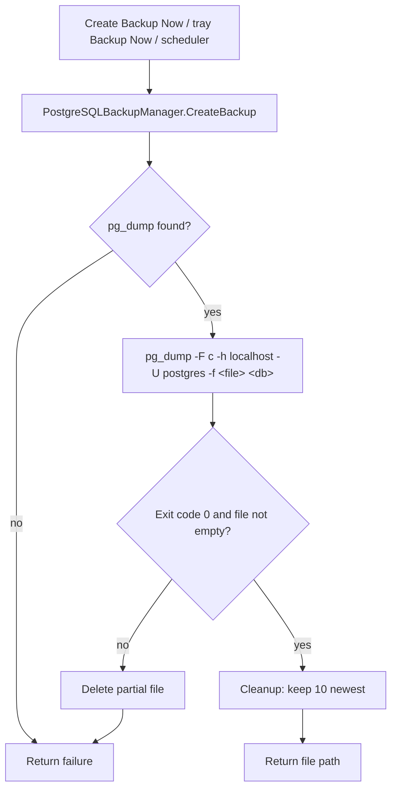

# pvncScheduler

A Windows desktop utility (VB.NET, Windows Forms, .NET 10) that backs up the **`pvnc` PostgreSQL database** on demand or on a schedule. It runs quietly in the system tray, can start automatically when you sign in to Windows, and keeps a rolling set of the 10 most recent backups.

Backups are written in PostgreSQL's **custom archive format** with a `.backup` extension — the same format pgAdmin produces — so they can be restored with pgAdmin or `pg_restore`.


---

## Contents

- [Features](#features)
- [Requirements](#requirements)
- [Building](#building)
  - [Single-file .exe (recommended for everyday use)](#single-file-exe-recommended-for-everyday-use)
  - [Icon](#icon)
- [Using the program](#using-the-program)
  - [Main window](#main-window)
  - [Manual backups](#manual-backups)
  - [Scheduled backups](#scheduled-backups)
  - [Running in the background (system tray)](#running-in-the-background-system-tray)
  - [Start with Windows](#start-with-windows)
  - [Diagnostics](#diagnostics)
- [Backup files](#backup-files)
  - [Naming](#naming)
  - [Retention (keep 10 newest)](#retention-keep-10-newest)
  - [Restoring a backup](#restoring-a-backup)
- [How it works](#how-it-works)
  - [Backup process](#backup-process)
  - [Scheduler](#scheduler)
  - [Settings storage](#settings-storage)
- [Project structure](#project-structure)
- [Configuration reference](#configuration-reference)
- [Troubleshooting](#troubleshooting)
- [Known limitations](#known-limitations)

---

## Features

| Feature | Details |
|---|---|
| **Manual backup** | "Create Backup Now" runs a backup in the background; the window stays responsive and the result appears in the status bar. |
| **Scheduled backups** | Daily, Weekly (pick a weekday) or Monthly (pick day 1–28 or *Last day*), at any hour from 00:00 to 23:00. |
| **System tray** | Closing the window hides it to the tray; the scheduler keeps running. Tray menu: Show / Backup Now / Exit. |
| **Start with Windows** | Optional checkbox that launches the program straight to the tray at sign-in. |
| **Single instance** | Launching it again while it's already running just brings the existing window forward, so backups can never be scheduled twice. |
| **Retention** | Keeps the 10 newest backups it created and deletes older ones, oldest first. |
| **Recent backups list** | Shows the 10 newest `.backup` files in the folder (name, size in MB, date) when the program starts and whenever the window is reopened. |
| **Diagnostics** | Checks that `pg_dump` can be found and tests the PostgreSQL connection. |
| **Persistent settings** | Folder, schedule, day, time and enabled state are saved automatically and restored on startup. |

---

## Requirements

- **Windows 10 or 11**
- **.NET 10 Desktop Runtime** for the Debug/Release builds (or the .NET 10 SDK to build). Not needed for the [single-file `.exe`](#single-file-exe-recommended-for-everyday-use), which includes .NET.
- **PostgreSQL client tools** — specifically `pg_dump.exe` (and `psql.exe` for the connection test). The program looks for them in:
  1. `C:\BouMatic\postgresql\bin\`
  2. `C:\Program Files\PostgreSQL\<15, 14, 13, 12, 11, 10, 9.6, 9.2>\bin\`
  3. `C:\Program Files (x86)\PostgreSQL\<same versions>\bin\`
  4. Anything on the system `PATH`
- A PostgreSQL server reachable on **localhost** with a **`postgres`** user that can read the `pvnc` database.

---

## Building

**Visual Studio:** open `pvncScheduler.slnx` and build (Debug or Release).

**Command line:**

```powershell
dotnet build pvncScheduler.vbproj               # Debug
dotnet build pvncScheduler.vbproj -c Release    # Release
```

Output: `bin\Debug\net10.0-windows\pvncScheduler.exe` (or `bin\Release\net10.0-windows\...`). These builds need the whole output folder and the .NET 10 Desktop Runtime installed.

### Single-file `.exe` (recommended for everyday use)

A self-contained, single-file build bundles the program and .NET into one `pvncScheduler.exe` (about 111 MB) that runs on any 64-bit Windows 10/11 PC without installing .NET:

```powershell
dotnet publish pvncScheduler.vbproj -c Release -r win-x64 --self-contained true -p:PublishSingleFile=true -p:IncludeNativeLibrariesForSelfExtract=true -o publish\win-x64-single-file
```

Output: `publish\win-x64-single-file\pvncScheduler.exe`. Copy just the `.exe` — the `.pdb` beside it is debugging information and isn't needed. PostgreSQL client tools are still required (see [Requirements](#requirements)).

### Icon

The icon is `LDSicon.ico` in the project folder. `<ApplicationIcon>` in `pvncScheduler.vbproj` embeds it in the `.exe`, and `Form1.vb` reads it back from the `.exe` at startup (`Icon.ExtractAssociatedIcon`) for the window and tray icon. To change the icon, replace `LDSicon.ico` and rebuild.

> **Close the program first.** Because closing the window only hides it to the tray, a running copy locks the `.exe` and the build or publish fails with *"The process cannot access the file ... because it is being used by another process"* or *"Access to the path ... is denied."* Right-click the tray icon → **Exit**, then build.

---

## Using the program

### Main window

| Control | Purpose |
|---|---|
| **Database** | Database to back up (default `pvnc`). |
| **Backup Folder / Browse...** | Where backups are written. Saved automatically when chosen. |
| **Create Backup Now** | Runs a backup immediately. |
| **Diagnostics** | Opens the diagnostics window. |
| **Schedule** | `Disabled`, `Daily`, `Weekly` or `Monthly`. |
| **Enabled** | Turns the schedule on or off. Backup Time and Day are only editable while this is checked. |
| **Backup Time** | Hour the scheduled backup runs (24-hour clock). |
| **Day** | Weekday (Weekly) or day of month (Monthly). Greyed out for Daily. |
| **Start with Windows** | Launch at sign-in, minimized to the tray. |
| **Password** | Password for the PostgreSQL `postgres` user. Saved automatically, encrypted for your Windows account. |
| **Recent Backups** | 10 newest backups in the folder. |
| **Status** (bottom left) | Result of the last action — green for success, red for errors. |
| **Scheduled Backup** (bottom right) | Current schedule, e.g. *Scheduled Backup: Weekly on Fridays at 02:00*. |

### Manual backups

1. Choose a backup folder with **Browse...**.
2. Click **Create Backup Now** (or right-click the tray icon → **Backup Now**).
3. The status bar shows *Backing up database: pvnc...* and then *Backup completed successfully: pvnc_YYYYMMDD_HHMMSS.backup*. The Recent Backups list refreshes.

Success is reported only in the status bar — there's no pop-up. A failure shows the status in red **and** an error dialog so it isn't missed.

### Scheduled backups

1. Pick a **Schedule**: Daily, Weekly or Monthly.
2. Check **Enabled**.
3. Pick a **Backup Time** and, for Weekly/Monthly, a **Day**:
   - **Weekly** — Sunday through Saturday.
   - **Monthly** — `1`–`28`, or **Last day** (28th–31st depending on the month). 29–31 are deliberately not offered because not every month has them.
4. The bottom-right label confirms the active schedule.

Changes to Schedule, Day or Time take effect immediately while Enabled is checked, and are saved.

> **The program must be running at the scheduled time** (window open or hidden in the tray). If the PC is **asleep** at the scheduled time, the backup runs within a minute of waking. If the PC is **off** or the program has been **exited**, that backup is skipped — for a Weekly or Monthly schedule, the next run is a week or a month away. Turn on **Start with Windows** to minimize missed backups.
>
> If a scheduled backup **fails** (server not running, backup folder not available yet, etc.), the status bar turns red and the backup is **retried every 15 minutes** until it succeeds or the next regular backup is due.

### Running in the background (system tray)

The program is designed to stay running:

| Action | Result |
|---|---|
| Click the window's **X** | Window hides; program keeps running in the tray. |
| Click **minimize** | Same — hides to the tray. |
| **Left-click** the tray icon | Show / hide the window. |
| **Right-click** the tray icon | Menu: **Show**, **Backup Now**, **Exit**. |
| Tray menu → **Exit** | Stops the scheduler and quits completely. |
| Launch the `.exe` again | Re-opens the already-running window (single instance). |
| Windows shutdown / sign-out | Program exits normally. |

If you don't see the icon, check the **^** (hidden icons) area next to the clock.

### Start with Windows

Check **Start with Windows** to have the program launch at sign-in, straight to the tray with no window.

- Stored per user in the registry at `HKCU\Software\Microsoft\Windows\CurrentVersion\Run`, value **`pvncScheduler`** = `"<path to pvncScheduler.exe>" --minimized`. No administrator rights required.
- Visible in **Task Manager → Startup apps** as `pvncScheduler`.
- Unchecking removes the registry value.
- The checkbox reflects the actual registry state each time the program opens. If the `.exe` has moved (e.g. you switched from a Debug build to the single-file `.exe`), opening the new copy once with the box checked updates the path.

You can also launch it hidden manually with:

```powershell
pvncScheduler.exe --minimized
```

### Diagnostics

The **Diagnostics** window opens with an automatic `pg_dump` check and offers:

- **Check pg_dump** — reports where `pg_dump.exe` was found (common install folders, then `PATH`).
- **Test Connection** — runs `psql -h localhost -U postgres -c "SELECT version();"` using `C:\BouMatic\postgresql\bin\psql.exe` and shows the result.

---

## Backup files

### Naming

```
pvnc_YYYYMMDD_HHMMSS.backup
```

Example: `pvnc_20261019_093431.backup` — created 19 Oct 2026 at 09:34:31.

### Retention (keep 10 newest)

After **every successful** backup (manual or scheduled), the program keeps the **10 newest** backups and deletes the rest, oldest first.

- **Only files the program created are touched** — names must match exactly `pvnc_YYYYMMDD_HHMMSS.backup`. Any other file in the folder (e.g. a manual `pvnc.backup` from pgAdmin, or unrelated files) is never deleted.
- **"Oldest" is determined by the timestamp in the file name**, not the file's dates, so OneDrive syncing, copying or restoring files can't cause the wrong backups to be removed.
- **A failed backup never triggers cleanup**, so an error can't cost you a good backup.
- The limit is the constant `MaxBackupsToKeep` in `PostgreSQLBackupManager.vb`.

Rough history kept: Daily ≈ 10 days, Weekly ≈ 10 weeks, Monthly ≈ 10 months.

### Restoring a backup

**pgAdmin:** right-click the target database → **Restore...** → choose the `.backup` file (Format: *Custom or tar*).

**Command line:**

```powershell
# Inspect the contents
pg_restore -l pvnc_20261019_093431.backup

# Restore into an existing (empty) database
pg_restore -h localhost -U postgres -d pvnc pvnc_20261019_093431.backup

# Or drop and recreate objects in an existing database
pg_restore -h localhost -U postgres -d pvnc --clean pvnc_20261019_093431.backup
```

> Older versions of this program wrote `.dump` files. They're the same custom format — rename them to `.backup` (or restore them as-is). They are not shown in the Recent Backups list or managed by retention unless renamed to the `pvnc_YYYYMMDD_HHMMSS.backup` pattern.

---

## How it works

### Backup process



Key details (`PostgreSQLBackupManager.vb`):

- **Command:** `pg_dump -F c -h localhost -U postgres -f "<folder>\pvnc_<timestamp>.backup" "<database>"`
  - `-F c` — custom (compressed, binary) archive format, restorable with `pg_restore`.
  - `-f` — `pg_dump` writes the file **directly**. Earlier versions piped the archive through stdout; with older `pg_dump` builds that produces dozens of *"ftell mismatch with expected position"* warnings and a bloated archive, and the unread warnings filled the stderr pipe and **deadlocked** the program. Writing straight to the file avoids both problems.
- **Password:** the password entered in the main window is passed to `pg_dump` via the `PGPASSWORD` environment variable of that child process only. If none is entered, `pg_dump` uses `%APPDATA%\postgresql\pgpass.conf` if it exists. `-w` stops `pg_dump` from ever waiting at a password prompt.
- **Output streams:** stdout and stderr are drained asynchronously so `pg_dump` can never block on a full pipe.
- **Timeout:** 10 minutes. On timeout the process is killed and the partial file deleted.
- **Threading:** manual backups run on a background task (`Task.Run`) so the UI never freezes; scheduled backups run on the scheduler's timer thread.
- **Success check:** exit code `0` **and** a non-empty file. Otherwise the file is deleted and `Nothing` is returned.

### Scheduler

`BackupScheduleManager.vb` works out the **next run time** when the schedule starts — the next scheduled day (always for Daily; matching weekday for Weekly; matching day-of-month or last day of the month for Monthly) at the chosen hour, strictly after now. A `System.Timers.Timer` ticks **every 60 seconds**, and the first tick at or after that time runs the backup. A late timer tick or a PC waking from sleep therefore still gets its backup.

- **Success** — the next run time moves to the next scheduled day; the main window refreshes its list and status (*Scheduled backup completed successfully.*).
- **Failure** — the backup is retried in 15 minutes (or at the next regular run, if that comes sooner), and the status bar shows *Scheduled backup failed. Retrying &lt;day&gt; &lt;time&gt;.* in red.
- **Only one backup runs at a time.** If a manual backup is running when a scheduled one is due, the scheduled one waits for it. Clicking **Create Backup Now** or tray → **Backup Now** while a backup is running just shows *A backup is already running.*
- Changing the schedule, day or time recalculates the next run from the current time.

### Settings storage

Settings are saved to:

```
%APPDATA%\pvncScheduler_settings.ini
```

```ini
BackupFolder=C:\Backups\pvnc
Schedule=Weekly
BackupTime=02:00
BackupDay=Friday
ScheduleEnabled=True
Password=AQAAANCMnd8BFdERjHoAwE/Cl+sBAAAA...
```

| Key | Values |
|---|---|
| `BackupFolder` | Absolute folder path. Kept on load even if the folder is missing (e.g. a network or USB drive not connected yet) — the status bar shows a warning and scheduled backups retry until it's available. |
| `Schedule` | `Disabled`, `Daily`, `Weekly`, `Monthly` |
| `BackupTime` | `00:00` – `23:00` |
| `BackupDay` | Weekly: `Sunday`–`Saturday`. Monthly: `1`–`28` or `Last day`. Empty for Daily. |
| `ScheduleEnabled` | `True` / `False` |
| `Password` | The PostgreSQL password, encrypted with Windows DPAPI. Only the same Windows user on the same PC can decrypt it; if the file is copied elsewhere, the program asks for the password again. Empty if none is saved. |

The **Start with Windows** setting lives in the registry (see [Start with Windows](#start-with-windows)), not in this file.

---

## Project structure

| File | Responsibility |
|---|---|
| `Form1.vb` | Main window logic: manual backups, schedule controls, settings load/save, tray behaviour, Start with Windows, recent-backups list. |
| `Form1.Designer.vb` | Window layout and control wiring (controls, tray icon, tray menu). |
| `PostgreSQLBackupManager.vb` | Locates `pg_dump`, runs the backup, enforces retention (`MaxBackupsToKeep`). |
| `BackupScheduleManager.vb` | Timer-based scheduler (Daily / Weekly / Monthly, day and time matching). Raises `BackupCompleted`. |
| `DiagnosticsForm.vb` | Diagnostics window UI. |
| `DiagnosticsHelper.vb` | `pg_dump` location check and `psql` connection test. |
| `ApplicationEvents.vb` | Single-instance handling — a second launch restores the existing window. |
| `My Project\Application.myapp` / `Application.Designer.vb` | VB application framework settings (startup form, single instance). |
| `pvncScheduler.vbproj` / `pvncScheduler.slnx` | Project and solution files (`net10.0-windows`, Windows Forms, application icon). |
| `LDSicon.ico` | Program icon for the `.exe`, window and tray. |
| `publish\win-x64-single-file\` | Output of the single-file publish (not source). |

---

## Configuration reference

These values are currently set in code:

| Setting | Where | Default |
|---|---|---|
| PostgreSQL host | `PostgreSQLBackupManager.vb` → `processInfo.Arguments` | `localhost` |
| PostgreSQL user | `PostgreSQLBackupManager.vb` → `processInfo.Arguments` | `postgres` |
| PostgreSQL password | **Password** box in the main window (stored encrypted, see [Settings storage](#settings-storage)) | *(none)* |
| `pg_dump` search paths | `PostgreSQLBackupManager.FindPgDump` | see [Requirements](#requirements) |
| Backups kept | `PostgreSQLBackupManager.MaxBackupsToKeep` | `10` |
| Backup timeout | `PostgreSQLBackupManager.CreateBackup` → `WaitForExit` | 10 minutes |
| Scheduler check interval | `BackupScheduleManager.StartScheduler` | 60 seconds |
| Database list | `Form1.Designer.vb` → `cmbDatabase.Items` | `pvnc` |

---

## Troubleshooting

| Symptom | What to check |
|---|---|
| *"Backup failed. Ensure pg_dump is installed and accessible."* | Open **Diagnostics** → **Check pg_dump**. Make sure PostgreSQL client tools are installed in one of the searched folders or on `PATH`. |
| Backup fails but `pg_dump` is found | **Diagnostics → Test Connection**. Confirm the PostgreSQL service is running (`services.msc`) and the `pvnc` database exists. |
| Build or publish fails: *file is being used by another process* / *Access to the path ... is denied* | The program is still running in the tray. Right-click the tray icon → **Exit**, then rebuild. |
| File Explorer still shows the old icon on the `.exe` | Windows' icon cache is stale. Refresh the folder, or sign out and back in. |
| No tray icon | Check the hidden-icons (**^**) area next to the clock. |
| Scheduled backup didn't run | Was the program running at that time? Is **Enabled** checked? Does the bottom-right label show the expected day/time? Runs missed while the PC was off or the program was exited are not caught up. A red *Scheduled backup failed* status means it's retrying every 15 minutes — use **Diagnostics** to find out why. |
| Program doesn't start at sign-in | Check **Start with Windows** is ticked and that `pvncScheduler` is enabled in **Task Manager → Startup apps**. If you moved or rebuilt the `.exe` elsewhere, open the new copy once. |
| Old backups not deleted | Retention only applies to files named exactly `pvnc_YYYYMMDD_HHMMSS.backup`, and only runs after a successful backup. |
| Need more detail on a failure | Run from Visual Studio in Debug and watch the **Output** window — `pg_dump`'s exit code and error text are written there. |

Manual check from a terminal:

```powershell
& "C:\BouMatic\postgresql\bin\pg_dump.exe" --version
& "C:\BouMatic\postgresql\bin\pg_dump.exe" -F c -h localhost -U postgres -f test.backup pvnc
```

---

## Known limitations


- **Local server only** — host and user are fixed to `localhost` / `postgres`.
- **Runs missed while the program wasn't running are skipped**, not run at the next startup. (Runs missed while the PC was asleep do run on wake.)
- **Hourly times only** (00:00–23:00).
- **Scheduled backup failures only show in the status bar** — there's no pop-up or notification, and details (pg_dump's error text) go only to debug output.
- **Diagnostics → Test Connection** uses a fixed `psql.exe` path under `C:\BouMatic\postgresql\bin\`.
